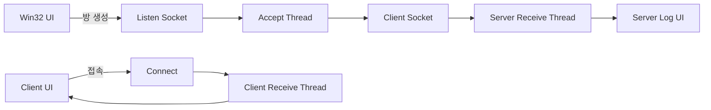

# ListenServer_Test

Win32 API와 Winsock2로 구현한 TCP 채팅 프로그램입니다. 서버와 클라이언트 창을 띄워 블로킹 소켓과 멀티스레드 기반의 통신 흐름을 실습합니다.

## 프로젝트 소개

프로그램을 실행하면 서버 창과 클라이언트 창이 함께 열립니다. 서버는 TCP 9000 포트에서 접속을 기다리고, 클라이언트는 서버에 연결해 메시지를 주고받습니다.

- 언어: C++20
- 플랫폼: Windows
- UI: Win32 API
- 네트워크: Winsock2, TCP
- 스레드: 서버 Accept 스레드, 연결별 수신 스레드, 클라이언트 수신 스레드

## 구현 내용

- 서버 소켓 생성, 바인딩, 연결 대기
- Accept 전용 스레드에서 클라이언트 연결 수락
- 연결된 소켓별 서버 수신 스레드 생성
- 클라이언트 수신 스레드에서 서버 메시지 수신
- 서버와 클라이언트의 채팅 로그 표시

## 동작 흐름

1. 프로그램을 실행하면 서버 창과 클라이언트 창이 열립니다.
2. 서버 창에서 **방 생성**을 누르면 `9000` 포트에서 연결을 기다립니다.
3. 클라이언트 창에서 **서버 접속**을 누르면 서버에 연결합니다.
4. 양쪽 창에서 메시지를 입력하고 전송합니다.

현재 클라이언트 주소는 `127.0.0.1`로 고정되어 있어 같은 PC에서 실행하는 시연을 기준으로 합니다.

## 구조

## 빌드 및 실행

1. MSVC v145와 C++20을 지원하는 Visual Studio 환경을 준비합니다.
2. 저장소의 `ListenServer_Test.slnx`를 엽니다.
3. `x64` 또는 `Win32`, `Debug` 또는 `Release` 구성을 선택해 빌드합니다.
4. 프로그램을 실행하고 서버 창에서 **방 생성**, 클라이언트 창에서 **서버 접속**을 차례로 누릅니다.

## 현재 구현 범위와 한계

- 서버는 여러 연결을 수락하고 연결별 수신 스레드를 생성합니다.
- 서버의 송신 소켓은 마지막 접속으로 덮어써지므로, 현재 서버 메시지는 마지막 접속자에게만 전달됩니다. 전체 접속자 대상 브로드캐스트는 구현되어 있지 않습니다.
- 클라이언트 접속 주소가 `127.0.0.1`로 고정되어 있습니다.
- TCP 메시지 프레이밍을 구현하지 않아, 한 번의 `recv`가 한 번의 메시지와 일치한다고 보장할 수 없습니다.
- 수신 스레드가 Win32 UI 컨트롤을 직접 갱신합니다.
- 소켓 오류 처리와 종료 시 스레드·소켓 정리는 보완이 필요합니다.

## 개선 계획

- 클라이언트별 연결 정보를 관리하고 메시지를 접속자에게 브로드캐스트
- 길이 헤더 또는 구분자를 이용한 메시지 프레이밍과 송수신 루프 구현
- `PostMessage` 등을 이용해 네트워크 스레드와 UI 갱신 분리
- 연결 종료와 재접속, 서버 종료 시 소켓 및 스레드 정리

## 관련 링크

- [프로젝트 설명 및 시연 화면](https://app.notion.com/p/3d0d1e10de0e805996b0e8162930bd42?source=copy_link)
- [개발 기록](https://euihyun1188.tistory.com/131)
- [GitHub 저장소](https://github.com/Big-Baek/ListenServer_Test)